<!-- Generated by tools/build_profile_ui.py; edit that script, then re-run it. -->

<picture>
  <source media="(max-width: 700px)" srcset="https://raw.githubusercontent.com/RohitJagdale/RohitJagdale/main/assets/ui/hero-mobile.svg">
  
</picture>

<picture>
  <source media="(max-width: 700px)" srcset="https://raw.githubusercontent.com/RohitJagdale/RohitJagdale/main/assets/ui/about-mobile.svg">
  
</picture>

<picture>
  <source media="(max-width: 700px)" srcset="https://raw.githubusercontent.com/RohitJagdale/RohitJagdale/main/assets/ui/missions-mobile.svg">
  
</picture>

<picture>
  <source media="(max-width: 700px)" srcset="https://raw.githubusercontent.com/RohitJagdale/RohitJagdale/main/assets/ui/loadout-mobile.svg">
  
</picture>

<picture>
  <source media="(max-width: 700px)" srcset="https://raw.githubusercontent.com/RohitJagdale/RohitJagdale/main/assets/ui/achievements-mobile.svg">
  
</picture>

<picture>
  <source media="(max-width: 700px)" srcset="https://raw.githubusercontent.com/RohitJagdale/RohitJagdale/main/assets/ui/snake-header-mobile.svg">
  
</picture>

<picture>
  <source media="(prefers-color-scheme: dark)" srcset="https://raw.githubusercontent.com/RohitJagdale/RohitJagdale/output/github-snake-dark.svg">
  
</picture>

<picture>
  <source media="(max-width: 700px)" srcset="https://raw.githubusercontent.com/RohitJagdale/RohitJagdale/main/assets/ui/footer-mobile.svg">
  
</picture>

<a href="https://www.linkedin.com/in/rohit-jagadale-317b5020b/">LinkedIn</a> · <a href="mailto:rohitjagadale4@gmail.com">rohitjagadale4@gmail.com</a>

