<div align="center">



<a href="https://git.io/typing-svg"></a>

<a href="https://www.linkedin.com/in/rohit-jagadale-317b5020b/"></a>
<a href="mailto:rohitjagadale4@gmail.com"></a>
<a href="https://www.credly.com/badges/353ecc9b-15c6-4e49-ad0b-f9968e63480a/linked_in_profile"></a>


</div>

---

## `> whoami`

```yaml
name:      Rohit Jagadale
role:      Software Developer @ KONE Elevator   # Aug 2023 → present
location:  Pune, India
focus:     [AI Agents, MCP, AWS Bedrock, Serverless, Digital Twins]
experience: 3+ years
currently: Teaching AI agents to fix code before humans have to
```

I'm a **Full Stack & Cloud Developer** who builds cloud-native platforms, AI-powered automation and developer-productivity tools. My day-to-day spans **AWS serverless architecture, CI/CD automation, digital twin platforms and LLM-based agents** wired into GitLab and the IDE. I like systems that run themselves — and ship faster because of it.

---

## `> ls ./projects`

<table>
<tr>
<td width="50%" valign="top">

### 🤖 MCP Servers for Jira & CVMS
Python **Model Context Protocol** servers that let autonomous AI agents inside **VS Code and Kiro IDE** fetch context, analyze issues and run developer workflows straight from the editor.

`Python` `MCP` `Tool Calling` `LLM`

</td>
<td width="50%" valign="top">

### 🛠️ Autonomous Risk-Remediation Agent
An AI agent plugged into **GitLab CI/CD** that fetches CVMS software-risk issues, analyzes them and opens **merge requests with AI-proposed fixes** — cutting manual remediation effort.

`AWS Bedrock` `GitLab CI/CD` `AI Agents`

</td>
</tr>
<tr>
<td width="50%" valign="top">

### 🔍 AI Code Review System
Automated reviewer on **AWS Bedrock + Lambda** that parses MR diffs, writes contextual **line-level feedback** and de-duplicates comments across review cycles.

`Bedrock` `Lambda` `Prompt Engineering`

</td>
<td width="50%" valign="top">

### 🚇 StationTwin — Metro Digital Twin
Real-time digital twin of metro stations: **3D visualization** in React + Three.js, **GraphQL on AppSync**, GenAI summaries every 8 hours, full stack in **AWS CDK**.

- ⚡ **40%** faster 3D model load
- 🚀 **50%** faster releases via GitLab CI/CD
- 📉 **25%** lower data-transfer latency

`React` `Three.js` `AppSync` `CDK` `Azure AD SSO`

</td>
</tr>
<tr>
<td colspan="2" valign="top">

### 🧾 Customer Onboarding Portal
Multi-step linked-form portal for customer site configuration with per-stage validation. Two-phase storage (in-progress metadata in **DynamoDB**, finalized drafts in **RDS PostgreSQL**), direct-to-S3 uploads of documents and 3D models via **pre-signed URLs**, and serverless REST APIs on Lambda + API Gateway.

`React` `Redux` `Python` `DynamoDB` `RDS` `S3` `CDK`

</td>
</tr>
</table>

---

## `> cat skills.json`

<div align="center">


</div>

| Domain | Stack |
|---|---|
| 🧠 **AI / Agentic** | AWS Bedrock · MCP · LLM Integration · AI Agents · Tool Calling · Agent Workflows · Prompt Engineering |
| ☁️ **Cloud & DevOps** | Lambda · S3 · CloudFront · ECS · EC2 · API Gateway · AppSync · DynamoDB · RDS · AWS CDK (TS) · GitLab CI/CD · Docker |
| 🎨 **Frontend** | React.js · Redux · Three.js · Chakra UI |
| ⚙️ **Backend** | Python · FastAPI · REST · GraphQL |
| 🗄️ **Databases** | MySQL · DynamoDB · RDS |
| 💻 **Languages** | TypeScript · Python · Java |

---

## `> achievements --list`

| | |
|---|---|
| 🏅 | **AWS Certified Developer – Associate (DVA-C02)** · valid Nov 2025 – Nov 2028 · [verify on Credly](https://www.credly.com/badges/353ecc9b-15c6-4e49-ad0b-f9968e63480a/linked_in_profile) |
| 🥈 | **AWS GameDay 2025 — 2nd Place** · Cloud Architecture & Operations challenge |
| 🥉 | **AWS DeepRacer 2024 — 3rd Place** · Reinforcement learning & AWS AI/ML |
| 🎓 | **B.Tech, Computer Science** · Rajarambapu Institute of Technology · 2023 |

---

## `> git log --stats`

<div align="center">


</div>

---

<div align="center">

### `> connect --open`

**Open to conversations on AI agents, cloud architecture and dev tooling.**

<a href="https://www.linkedin.com/in/rohit-jagadale-317b5020b/">LinkedIn</a> ·
<a href="mailto:rohitjagadale4@gmail.com">rohitjagadale4@gmail.com</a>


</div>
